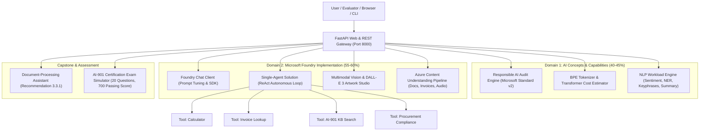

# Azure AI Foundry Suite (AI-901 Enterprise Solution)

**Author:** Arnav Sharma  
**Institution:** Chandigarh University, Gharuan  
**Department:** Computer Science & Engineering  
**Credential:** Microsoft Certified: Azure AI Fundamentals (AI-901)  
**Syllabus Aligned:** Microsoft Learn AI-901 Skills Measured (April 15, 2026)  

---

## 📌 Executive Summary & Document Mapping

This project is the complete, practical software implementation of the industrial internship report:  
**“AZURE AI FUNDAMENTALS (AI-901): LEARNING AND IMPLEMENTING AI SOLUTIONS USING MICROSOFT FOUNDRY”** submitted by **Arnav Sharma** at **Chandigarh University**.

The project directly maps to the two core domains of the **AI-901 Examination**:
1. **Domain 1: Identify AI Concepts and Capabilities (40–45%)**
   - **Week 1:** The 6 Principles of Responsible AI (*Fairness, Reliability & Safety, Privacy & Security, Inclusiveness, Transparency, Accountability*)
   - **Week 2:** Generative AI, Transformer mechanics, BPE Tokens, Model Selection (Phi-3.5 vs GPT-4o), Parameter calibration (*Temperature, Top_P, Max Tokens*), and Common Workloads (*Sentiment, NER, Keyphrases, Summarization*)
2. **Domain 2: Implement AI Solutions by Using Microsoft Foundry (55–60%)**
   - **Week 3:** System and user prompt engineering, lightweight Python Chat client with Foundry SDK, Single-Agent Solution with autonomous tool-calling (ReAct loop), and Speech neural voice synthesis
   - **Week 4:** Multimodal vision inspection (Visual Question Answering & OCR), DALL-E 3 generative visual canvas, and Azure Content Understanding pipelines for documents, forms, invoices, and multi-speaker audio recordings
3. **Capstone Solution (Report Recommendation 3.3.1):**
   - *"The skills of a fundamentals course are best consolidated by a small end-to-end project, such as a document-processing assistant that uses information extraction together with a chat client, built and documented independently."*

---

## 🏛️ System Architecture



---

## 🚀 Quick Start Guide

### 1. Requirements
- Python 3.10+ (Tested on Python 3.13)
- Required packages are listed in `requirements.txt`:
  ```bash
  pip install -r requirements.txt
  ```

### 2. Launching the Web Studio
You can run the web dashboard using either the Windows batch script or direct Python command:

**Option A (Windows Double-Click):**
Double-click `run_studio.bat`.

**Option B (Command Line):**
```bash
python main.py
```
Open your browser and navigate to:  
👉 **http://127.0.0.1:8000**

---

## 💻 Standalone CLI Lab Scripts

The `cli/` folder contains dedicated scripts matching the hands-on lab modules described in Week 1, 2, 3, and 4:

| CLI Tool | Description | Report Week |
| :--- | :--- | :--- |
| `python cli/responsible_ai_cli.py` | Audits predefined & custom scenarios across all 6 principles | Week 1 (Day 2-5) |
| `python cli/text_analysis_cli.py` | Runs Sentiment Analysis, NER, Keyphrase Extraction, and Summarization | Week 2 (Day 4) |
| `python cli/foundry_chat_cli.py` | Interactive terminal chat client with system prompt and token metrics | Week 3 (Day 3) |
| `python cli/foundry_agent_cli.py` | Autonomous Agent demonstrating Thought-Action-Observation tool loop | Week 3 (Day 4) |
| `python cli/content_understanding_cli.py` | Extracts structured JSON & tables from invoices and diarized audio | Week 4 (Day 3-4) |

---

## 🧪 Automated Test Suite

A complete test suite is provided in `tests/test_suite.py` verifying all 9 core services:
```bash
python tests/test_suite.py
```
**Test Results:**
```text
.........
----------------------------------------------------------------------
Ran 9 tests in 0.161s

OK
```

---

## 🔑 Azure OpenAI & Foundry API Connectivity (Optional)

The application includes an offline-capable, high-fidelity **Microsoft Foundry Local Inference Engine** that runs out of the box with zero external configuration.

To connect live to your Azure OpenAI or Azure AI Foundry deployment, copy `.env.example` to `.env` and provide your credentials:
```env
AZURE_OPENAI_KEY=your_azure_key_here
AZURE_OPENAI_ENDPOINT=https://your-resource-name.openai.azure.com/
AZURE_OPENAI_DEPLOYMENT=gpt-4o
AZURE_OPENAI_API_VERSION=2024-02-15-preview
```

---

## 📂 Project Structure

```text
d:\inter_project\
├── main.py                          # Application entry point (FastAPI server)
├── run_studio.bat                   # Windows one-click launcher
├── requirements.txt                 # Python dependencies
├── .env.example                     # Environment configuration template
├── README.md                        # Project documentation
│
├── app/
│   ├── config.py                    # Environment and project settings
│   ├── main.py                      # FastAPI routes & API endpoints
│   ├── services/
│   │   ├── responsible_ai.py        # 6 Principles audit engine & scorecard
│   │   ├── text_analysis.py         # Sentiment, NER, Keyphrases, Summarization
│   │   ├── foundry_chat.py          # Foundry Chat Client & BPE Tokenizer
│   │   ├── foundry_agent.py         # Single-agent solution with ReAct tools
│   │   ├── multimodal_vision.py     # Multimodal VQA & DALL-E 3 image generation
│   │   ├── content_understanding.py # Document, invoice & audio diarization
│   │   ├── capstone_assistant.py    # Document assistant (Recommendation 3.3.1)
│   │   └── exam_engine.py           # AI-901 Practice Exam Simulator
│   ├── templates/
│   │   └── index.html               # Modern Single Page Application UI
│   └── static/
│       ├── css/style.css            # Microsoft Fluent dark theme styles
│       ├── js/app.js                # Frontend interactivity & speech synthesis
│       ├── images/                  # Extracted report figures (Fig 1.1, Fig 2.1)
│       └── samples/                 # Sample invoices, agreements, transcripts
│
├── cli/                             # Standalone hands-on CLI tools
│   ├── responsible_ai_cli.py
│   ├── text_analysis_cli.py
│   ├── foundry_chat_cli.py
│   ├── foundry_agent_cli.py
│   └── content_understanding_cli.py
│
└── tests/
    └── test_suite.py                # Automated unit tests
```

---

## 🎓 Academic Credit & Acknowledgments
- **Candidate:** Arnav Sharma (UID: [UID])
- **Degree:** Bachelor of Engineering in Computer Science & Engineering
- **Institution:** Chandigarh University, Gharuan
- **Supervision:** Program Leader & Faculty Examiners
- **Course:** Microsoft Azure AI Fundamentals (AI-901)
